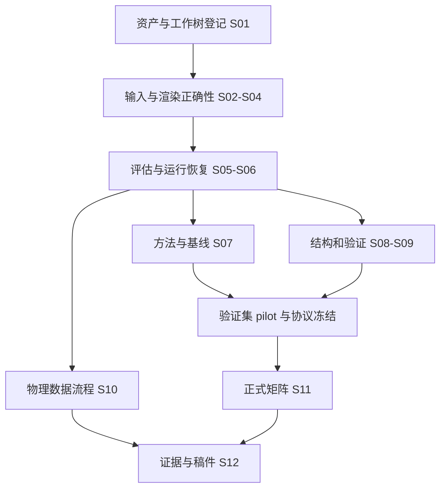

# CAAP Agent 执行计划

**目标：将当前研究原型变成可以审计、复跑和逐条回应大修意见的实验系统；以测试和证据定义完成，不以 ASR 高低定义成功。**

计划版本：`caap-revision-plan-v1`，编制日期：2026-10-14。当前状态：**文档设计、审查修订与最终一致性检查已完成；未执行以下开发与实验**。

独立复审确认派生任务合同无阻断项：`01-协议与产物契约.md` §7 按任务类型规定输入、科学键、必需产物、恢复和失效传播，对应验收位于 S06/S11/S12。全部 11 份文档的本地链接、Markdown 围栏、标题深度和异常字符检查通过，编辑器诊断未报告问题。文档审查通过不等于代码测试或真实实验通过，真实资产与正式协议仍需 D0/D1 确认。

## 1. 使用方式与文件职责

| **文件** | **职责** |
| --- | --- |
| [01-协议与产物契约](01-协议与产物契约.md) | 数据角色、攻击能力、预算、指标、产物和失败语义的唯一规范 |
| [02-开发切片与验收](02-开发切片与验收.md) | S01–S12 的代码落点、依赖、实现步骤和测试断言 |
| [03-实验矩阵与判定](03-实验矩阵与判定.md) | pilot、正式矩阵、种子、统计分析与阴性结果处理 |
| [04-Agent自治与恢复](04-Agent自治与恢复.md) | 自动纠错、复跑、资源限制、恢复与关键通知 |
| [理解文档入口](../doc/README.md) | 背景、审稿意见和创新动机 |

后续可向 Agent 发出任务：“按 `plan/README.md` 执行 CAAP 修订计划，先完成无真实数据依赖的开发和测试；在已授权范围内自主纠错，按 D0/D1/D2 汇报。”

**本计划本身不授权本次会话启动训练、下载资产、提交 Git 或开展采集。** 执行阶段仍须遵守宿主工具权限；已批准范围内不反复确认普通步骤，权限不足时集中说明，绝不绕过审批。

## 2. 当前工作区与保护范围

工作区：`/Users/lien/Desktop/CAAP`。

| **位置** | **当前事实** | **执行规则** |
| --- | --- | --- |
| `CAAP_code/` | Python/PyTorch；独立 Git 仓库；分支 `revision/tifs-major` | 修改前记录 HEAD、状态、diff；保留现有改动 |
| `caap_revision/` | 合成数据、合成权重、历史 smoke、示例 CSV | 仅作离线夹具；不能生成论文数字 |
| 两份根目录 PDF | 原稿与审稿信 | 只读；不上传外部服务，不复制个人联系信息到报告 |
| `doc/`、`plan/` | 理解材料与本规范 | 按协议版本维护一致性 |
| 真实数据/权重/实拍/LaTeX | 本轮未找到 | 记录资产缺口，不猜路径、不编内容 |

本机为 macOS；本轮 Python 检查 `torch` 不可用、`pytest` 可用。这是检查时的环境，不是以后永远成立的事实。执行时重新探测解释器、环境和获准 GPU。

不得删除 `.codebuddy/`，不得重置工作树、自动提交/推送、覆盖旧结果或迁移整个项目结构。

## 3. 任务图与门禁

S01 中真实资产缺失不阻断合成夹具开发。图中“资产登记完成”表示缺口已明确，不表示数据已提供。

| **门禁** | **进入条件** | **不通过时** |
| --- | --- | --- |
| G0：可开发 | 工作树快照、解释器和依赖计划明确 | 无依赖时可写代码/审查，不能标测试通过 |
| G1：输入/渲染可信 | S02–S04 CPU 断言与负例通过 | 禁止正式训练 |
| G2：评估/恢复可信 | S05–S06、S09 小样本测试及保存恢复通过 | 不产生可入稿结果 |
| G3：协议冻结 | 真实资产审计、洁净基线、pilot、资源预算、独立审查 | 请求 D1 决策，不读最终测试做调参 |
| G4：实验有效 | 正式运行记录完整、全部重要条件/种子已决算 | 缺失、失败与阴性结果分开标记 |
| G5：可交付 | reviewer→证据→稿件位置闭环，限制完整 | 保持“部分完成”，不自动宣称可接受 |

## 4. Agent 角色和并发规则

- **控制 Agent**：维护协议版本、依赖图、资源和状态，不参与挑选有利测试结果。
- **实现 Agent**：一次领取一个切片，以验收断言为边界；不能顺手改论文主张或全局协议。
- **独立审查 Agent**：只读审查 diff、测试结果和科学口径；实现者不能自行免除失败断言。
- **实验 Agent**：只调度冻结矩阵，汇总所有成功、失败和中断；不得临时增加 seed 或变换追求显著性。
- **稿件 Agent**：只用有效证据写作；保留负结果、缺口与文献核验状态。

同一源文件同一时刻只有一个写入者。`attack.py`、`main.py` 和 `stats.py` 是冲突热点，S02–S07 相关修改优先串行。独立测试、元数据整理和只读审查可并行。

每个派发任务必须给出：切片 ID、协议版本、允许修改路径、前置产物、禁止事项、验收测试、预算和返回字段。不能只说“实现验证评估”。

## 5. 执行前一次性确认 D0

收集以下项目，用一条消息集中询问缺失项；已能从资产台账确认的不要再问：

1. 数据与识别器权重路径、来源、类别映射、授权使用范围。
2. 原实拍/日志/稿件源码是否可用，既有同意是否覆盖新增采集与对照。
3. 可用 Python/CPU/GPU 环境，是否允许安装依赖，存储上限和总 GPU-hours。
4. 允许的研究范围：先完成核心未定向复评；定向、额外设备、外部模型等是否纳入。

没有 GPU 预算时默认**正式训练预算为 0**；不把论文机器配置当资源授权。没有安装许可时不修改全局 Python；先给出兼容的独立环境方案。

## 6. 第一轮实际执行顺序

1. 读四份执行规范和 `doc/01-论文讲解.md`，再核查当前工作树是否与快照一致。
2. 创建未来执行台账 `caap_revision/execution/state.json`，标记全部切片 `pending`；现有 smoke 保持 `synthetic`。
3. 处理 S01–S06 的无资产依赖部分，逐切片执行“失败测试 → 最小修复 → 回归 → 独立审查”。
4. 实现 S07–S10；真实资产不全时使用明确标记的夹具验证接口，不替代正式实验。
5. 获得数据和算力后做验证集 pilot，生成冻结配置和矩阵，请求一次 D1 决策。
6. 运行 S11；最终测试仅用于预设矩阵报告，不反向驱动搜索。
7. S12 生成证据包和逐条回复修改建议；若论文源码未提供，停在明确的改稿清单。

具体命令在切片中是**目标接口和验收命令**，相关模块完成前不得假装它们已存在。若宿主要求对文档中的命令另行确认，先集中确认待执行命令集。

## 7. 完成与交接

每个切片返回：`status`、修改文件、测试命令及退出码、环境、证据路径、协议影响、残留风险和下一依赖。

`DONE` 表示实现且验收通过；`BLOCKED_ASSET`、`BLOCKED_PERMISSION`、`FAILED_TECHNICAL`、`DEFERRED_SCOPE` 不能写成 DONE。ASR 低但记录完整的正式实验可以是 `SUCCEEDED`，不能记为技术失败并自动调参重跑。

整个计划只有全部承诺范围已决算、证据可追溯、限制已披露时才可标记完成。存在实拍或数据缺口时，交付“部分完成及剩余决策”，不无限等待也不伪造完成。
